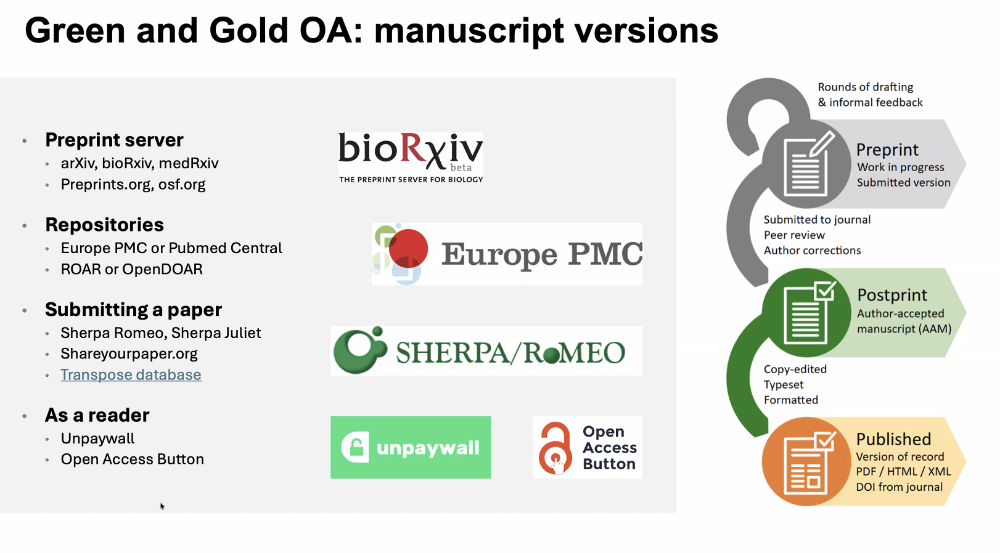
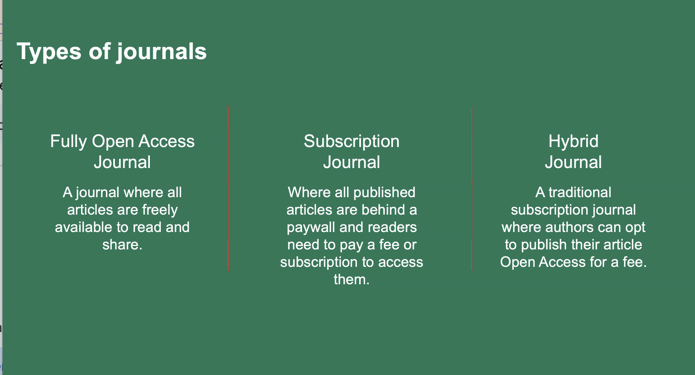
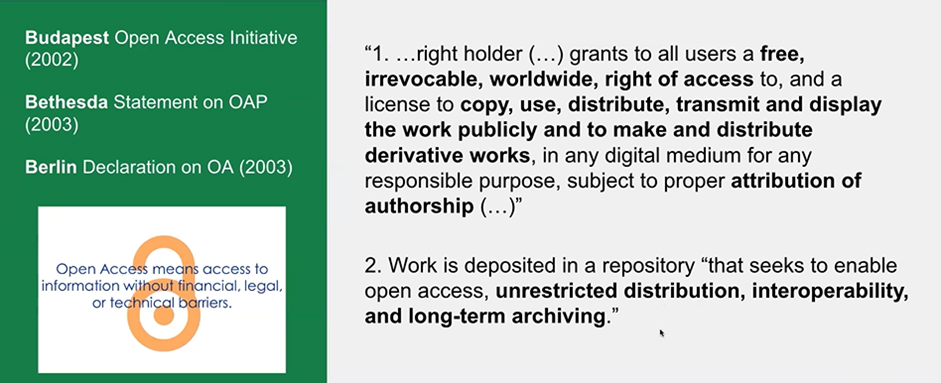
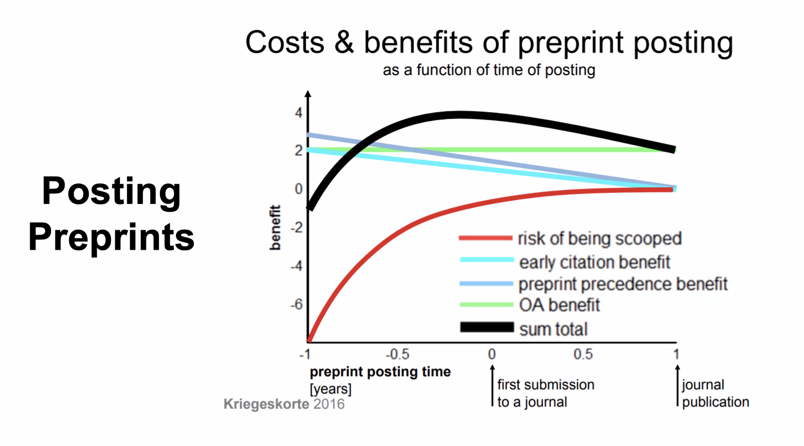
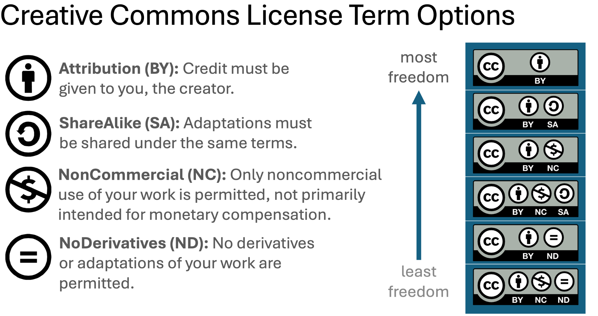
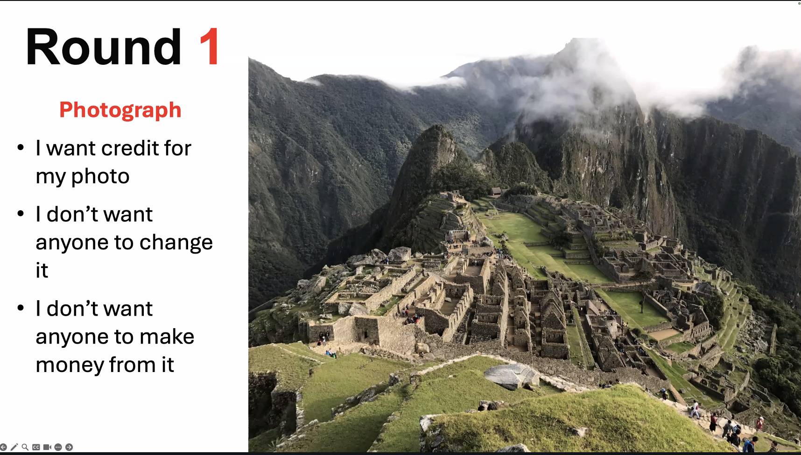
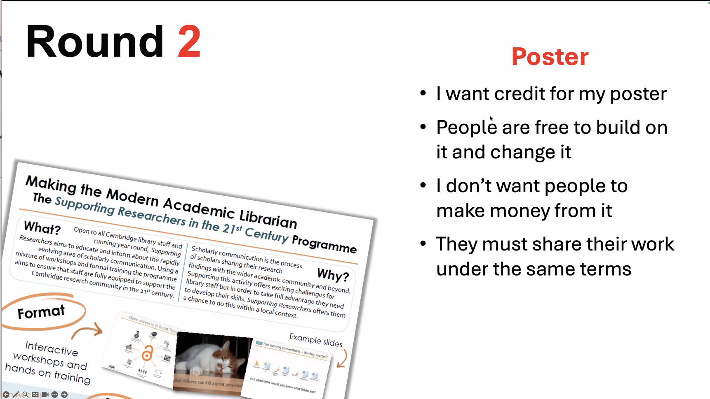

# 2. Open access for scientific publications

For a research publication to be truly Open Access, the article must be free to read and free to reuse. Open Access for publications addresses the long-term accessibility of research outcomes presented in scientific publication. The two most well-known types of open access are Gold Open Access and Green Open Access.

-   Gold Open Access is when the published version of an article is made open access usually in exchange for a fee called an Article Processing Charge (APC). It enables immediate access to the published version of an article usually under a Creative Commons Attribution (CC BY) licence.
-   Green Open Access also known as self-archiving is when the Author Accepted Manuscript is deposited in an open subject-specific or institutional repository. Green Open Access is free for authors to deposit. The Author Accepted Manuscript is post peer-review but before the publisher has copy-edited the article.

Publishers have different types of business models for journals:

-   A traditional subscription journal is when all articles are published behind a paywall. To access the articles, researchers must have a subscription either individually or through their institution, or they can pay for access per article.
-   Hybrid journals are a traditional subscription journal that gives authors the option to publish their article Open Access in return for paying an APC. The disadvantage of this is that publishers charge twice since the library still has to subscribe to the journal plus the author has to pay for the article to be published open access. This is why many funders no longer cover APCs in hybrid journals.
-   Fully Open Access journals, where all articles are published Open Access in exchange for an APC which is the publisher’s only form of income. Ironically, APCs tend to be cheaper for fully Open Access journals than for hybrid journals.

The major problem with Open Access in practice is that it follows market forces and Gold OA is the primary way of publishing. Gold Open Access creates major barriers for authors who cannot afford to pay an APC. Initially the idea was to move the money from subscription toward publication costs (reducing costs of subscriptions by covering the costs through APCs), but since publishers don't lower their subscription fees it became increasingly difficult for institutions to find funds to cover APCs.

To counteract this, institutions are introducing Rights Retention policies that allow their authors to self archive their **Author Accepted Manuscript**[^1] for immediate open access under the CC BY licence, and so promoting Green open access.

Alternative publishing business models are being sought such as Diamond Open Access or the cost free and formal peer review by the community or journal, referred to as publish, review, curate model.

**Following tools can be used to check the requirements by the funder and the status of the open access of your publication**

-   Journal checker tool
-   Think check submit

## 2.1 ORCID

Every researcher should have an Open Researcher and Contributor ID (ORCID) in order to publish research results. ORCID is an important and unique identifier to which all research outcomes and publications are linked. The ID remains the same over the whole of a researcher’s career path, even if a researcher changes institutions. In order to create an ID, researchers need to register on the ORCID website [https://orcid.org](https://orcid.org/). After registration the ID should be used during all submissions. It can be used to help authors claim new as well as past publications in Europe PMC.

## 2.2 What is Europe PMC and why use it?

Europe PMC ([https://europepmc.org/](https://europepmc.org/) ) is a free open database of life sciences literature from trusted sources. It is the repository of choice for international science funders and partners in the PubMed Central International archive network (PMC).

Using it allows for innovative searches for articles and preprints, full-text and abstracts. The accessible data links to over 40 databases. In addition, researchers may search by experimental data. Articles are enriched by peer reviews, protocols and reagents, funding, citations and more.

## 2.3 Creative Commons licences

To ensure that articles are free to reuse, Creative Commons licenses have become the standard open licenses applied to publications. They range from the most flexible Creative Commons Attribution (CC BY) to the most restrictive Creative Commons Attribution Non-Commercial No Derivatives (CC BY-NC-ND). It is important to note that not all Creative Commons licences are considered Open Access; only the CC BY licences without additional extensions (e.g. ND, NC…), which allows the greatest re-use can be considered Open Access. Most open CC BY licence is the requirement of many funders (UKRI, Wellcome Trust...).

!!! note "To do"
    To be added after the course: CC and AI

!!! question "Exercise 4: Creative commons licencing"

    **Duration:** 15 mins

    **Instructions:** Give fellows 4 different scenarios and ask what licences would you apply. Ask fellows to pop the answers in the chat or in the Slido. Discuss the correct answers and misconceptions

    **a)** Which licence should be used for this:

    

    **b)** Which licence should be used for this:

    

    Answers:

    **a)** CC-BY-NC-ND B) C) D)

[^1]: The AAM is the version of the manuscript **after** it has gone through peer review and been formally accepted by the journal editor, but **before** the publisher has applied their final formatting
