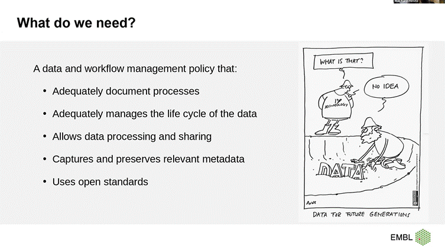
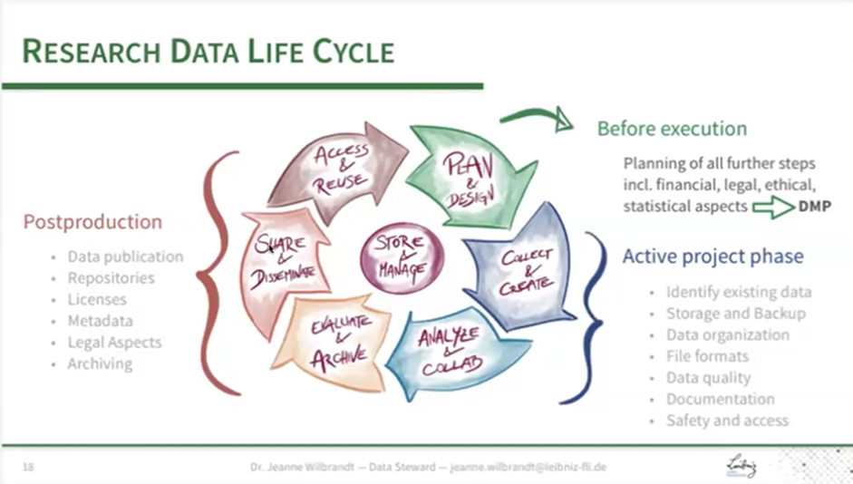
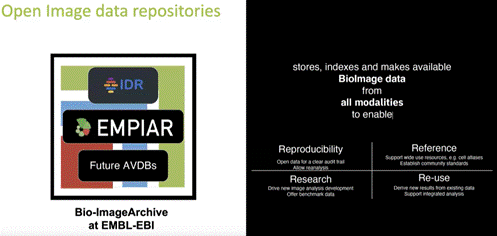

# 3. Open data and open software

Data is often the most valuable output of research projects as it underpins the derivation of knowledge. They can be classified as research data and metadata.

**Research data** is all data that was used or produced in a project. This also includes simulation, observational data, as well as code and scripts (software). Shared data can be raw or processed.

**Metadata** is the data on data. This means administrative, descriptive and structural data as well as the Who, When, How and Why. It is also information about resources, reagents, experimental information, treatment and conditions. With regard to reuse - Metadata also includes information on reuse, location and persistent identifiers.

The challenge with making data open is how to share data so that it is understandable and re-usable by others (humans and machines). For this purpose, FAIR principles were introduced. The FAIR principles are a set of guidelines for making research data Findable, Accessible, Interoperable, and Reusable, with the goal of improving the management and use of digital research data for both humans and machines:

-   **findable** → using appropriate naming, open repository
-   **accessible** → once you find the data it is actually accessible by the human and the machine used by the human
-   **interoperable** → data format that can be processed by different software
-   **reusable** → allow future discoveries with the data

FAIR emphasises the use of open standards and machine actionability, with the focus on metadata supported by good data management practices.

More on the FAIR principles can be found here: [https://www.go-fair.org/fair-principles/](https://www.go-fair.org/fair-principles/)

FAIR represents a spectrum as there is not a single way to measure each FAIR aspect (e.g. findability - something can be findable by a search engine, but it might be on the 20th page, which reduces the chance that the person finds it), and the FAIR aspects are complicated to quantify.

## 3.1 Introduction to Data management

It is important to consider the data and actual discovery behind each scientific paper. Accordingly, all projects should have a data management plan.

Good data management is the pre-condition for open data, facilitating:

-   Transparency (e.g. for reporting)
-   Error prevention
-   Data processing (i.e. automation)
-   Cost reduction (in space and time → e.g. move data to cheaper storage)
-   Collaborative work
-   Improving trust (e.g. via reproducibility)

Data management changes over time, as the project develops, and goes through 3 stages:

1.  Before execution - planning and designing
2.  Active project phase: collecting, creating, analysing, collaborating, evaluating and archiving
3.  Post-production: sharing, disseminating, accessing and reusing

Attribution: Wilbrandt, J. (2021, October 18). Data Management Plans for Beginners \[Workshop\]. Zenodo. [https://doi.org/10.5281/zenodo.5575921](https://doi.org/10.5281/zenodo.5575921)

Two awards are celebrating the sharing of research data:

-   The Symbiont Awards → [https://researchsymbionts.org](https://researchsymbionts.org)
-   The Parasite Awards → [https://researchparasites.org](https://researchparasites.org)

## 3.2 Data Management Plan

The Data Management Plan is a document of how the data will be handled, transferred or published and its first version is written at the beginning of the project (hence the “**plan”**). Having a data management plan is a requirement for every single research project. The plan should be deposited in a reliable community trusted repository. It is necessary to be done at project level which means that the researcher, group leader or collaborator should work on the plan in equal measure so that everyone has the same understanding of processes and obligations.

The data management plan should be an active document which is adapted and modified throughout the life of the project.

Moreover, the document should be structured in such a way that everyone outside the research group understands how the data is/was handled.

## 3.3 Data repositories

A **data repository** is a platform where researchers store, manage, and share datasets. Repositories give data a permanent identifier, add metadata to make it findable, and provide clear conditions for access and reuse. Repositories can be:

-   institutional
-   disciplinary - for specific technology or output type, GenBank (DNA sequences), or the Protein Data Bank (protein structures).
-   general purpose repositories - open to all disciplines. E.g. Zenodo.

Repositories often enforce **standards and formats** so data are easier to find, access, and reuse.

Good overview of repositories for life science field can be found here: [https://fairsharing.org/](https://fairsharing.org/)

!!! example "Example: Image data repository"

    [Bio-ImageArchive](https://www.ebi.ac.uk/bioimage-archive/) at EMBL-EBI stores, indexes and makes data available from all imaging modalities to enable research, reproducibility, reference and reusability.

    -   Bio-ImageArchive stores all bio image data
    -   Since there is so much data the vision is to help with novel research
    -   On top of the Bio-ImageArchive it is possible to build added value databases, e.g. EMPAIR stores electron microscopy and x-ray data

    
