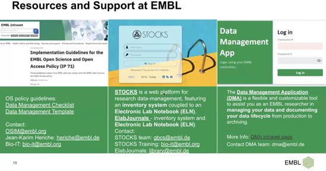
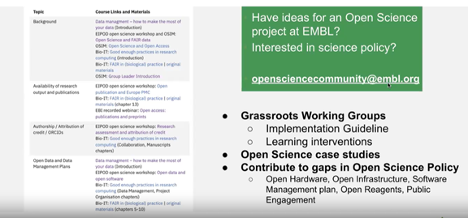
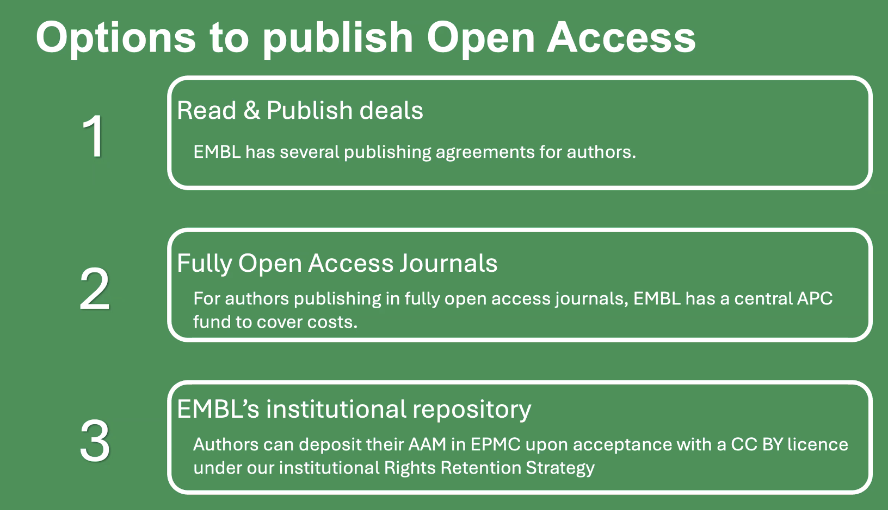
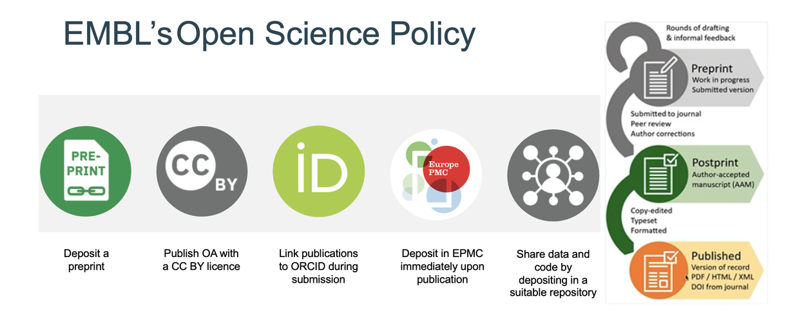
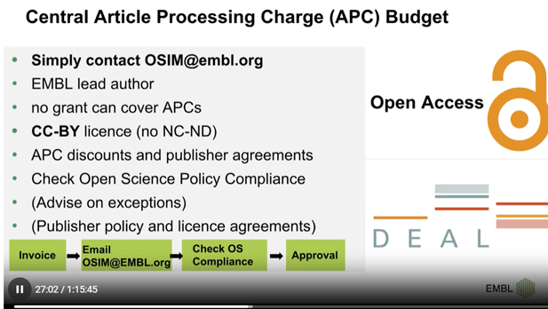
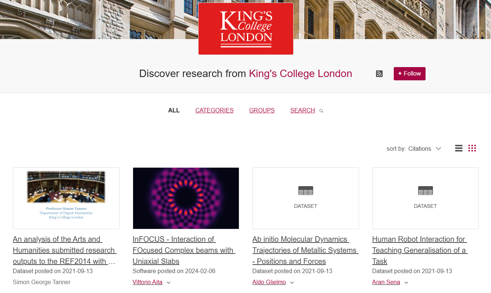

---
tags:
  - EMBL
  - lifescience
  - Europe
  - Kings
  - UK
  - ERIC
  - imaging
---

# 5. Examples of how open science is implemented by different organisations

!!! example "Example: Open Science at EMBL"

    \#EMBL \#lifescience \#Europe

    EMBL has an [Open Science Policy](https://www.embl.org/documents/document/internal-policy-no-71-open-science-and-open-access/) since 2021 and was updated in 2025 which applies to publications, data, and software.

    **What do we mean by open science at EMBL?**

    -   Research methods and outputs are made publicly available to support transparency and quality.
    -   Assessment is based on the merits of the work.
    -   Adoption of best practices that support the full and unambiguous attribution of credit to staff, EMBL and EMBL scientific facilities and funding organisations.

    It means no evaluation of the work based on the journal impact factor or the co-authors →proper assessment also involves data, code, workflow etc.

    **Open Science Support At EMBL**

    EMBL has set up various contact points to support researchers with regard to Open Science.

    

    The following list shows where you can get support:

    -   [Office for Scientific Information Management](https://www.embl.org/about/scientific-information-management/) → [OSIM@embl.org](mailto:OSIM@embl.org)
    -   [Data Science Center](https://www.embl.org/about/info/data-science-centre/) and BioIT → [bio-it@embl.org](mailto:bio-it@embl.org)
    -   [LabID](http://labid.embl.org) app– web platform for research data-management → [gbcs@embl.de](mailto:gbcs@embl.de)
    -   [Data management checklist](https://docs.google.com/document/d/1bIWD0xQuvVupXE6s0AokUzpBqyBXn7kMhsprdI9No-Y/edit?tab=t.0#heading=h.kj1q1lx0vvkc)
    -   [Data management plan template](https://docs.google.com/document/d/1OZLuun6F3s3Hwwy0vM7ciWS2WevRuzlBJMEIDyW_cdk/edit?tab=t.0)
    -   [Data Management Application](http://dma.embl.de) (DMA) – tool to assist managing data and documenting researcher’s data lifecycle → [dma@embl.de](mailto:dma@embl.de)
    -   [EMBL Open Science Community & Podcast](https://www.embl.org/about/info/open-science/) → [osim@embl.org](mailto:osim@embl.org)

    **Office for Scientific Information Management (OSIM)**

    The team supports staff in accessing the scientific information they need through the [Szilard Library](https://www.embl.org/about/info/szilard-library/). It supports open science best practices, aligned with the EMBL Open Science policy. Moreover, OSIM provides archiving and records management for EMBL as an organisation.

    

    A special service at EMBL is a procedure for retaining lab notebooks for ten years after a group leader leaves. Following the transition to the use of digital lab notebooks, OSIM started to implement a new standard procedure to retain electronic lab notebooks in 2024.

    For all interested in Open Science at EMBL, there is an open science community reachable on [opensciencecommunity@embl.org](mailto:opensciencecommunity@embl.org) that helps to update the implementation guidelines, learning interventions, analysing Open science case studies, and contributing to the gaps in Open Science Policy (Open Hardware, Open infrastructure, Software management plan, Open Reagents, Public engagement)

    The OS community put together training materials on open science:

    [https://www.embl.org/about/info/open-science/open-science-training-resources/](https://www.embl.org/about/info/open-science/open-science-training-resources/)

    **EMBL’s Open Science Policy**

    EMBL updated its [Open Science Policy](https://www.embl.org/internal-information/documents/ip-71-open-science-and-open-access-policy/) in 2025. To assist authors in complying with the Open Science Policy, implementation guidelines were created.

    **Open access for publications**

    *Publishing articles*

    All EMBL publications must be made immediately open access upon publication with a CC BY license. The paper must be deposited in Europe PMC which is EMBL’s institutional repository. Before an article is published, a preprint should be deposited in a EPMC indexed repository. If the journal is part of the Europe PMC this will be done automatically. If not, it can be done through a portal called Europe PMCplus.

    As of 2025, EMBL implemented a Rights Retention Strategy to ensure that authors can continue to publish in most journals while at the same time controlling publishing costs. EMBL will no longer pay for APCs in hybrid journals. There are three routes to publishing open access:

    1.  Through a current publishing agreement. All publishing agreements can be found on the Library website.
    2.  In a fully open access journal, e.g. PLOS or Frontiers.
    3.  Via Rights Retention Route which allows authors to deposit their Author Accepted Manuscript in a repository with a CC BY license immediately upon publication.

    

    It is important to note that other funding agencies might have stricter requirements.

    All researchers are also required to have an ORCID ID and to acknowledge EMBL affiliation.

    The following slides show the recommended steps for publishing an article:

    

    

    *Reading articles*

    EMBL has Open Access [Publish and read agreements](https://www.embl.org/about/info/szilard-library/open-access/open-access-agreements-with-publishers/) with Springer Nature, Wiley, Elsevier, CoB, RSC, Frontiers, and MDPI.

    EMBL library can help with getting access to a closed article, email [library@embl.org](mailto:library@embl.org).

    **Open data at EMBL**

    According to the EMBL OS policy, research data coming from the EMBL researchers must be Open (however, this does not apply to sensitive data such as human data for example) and deposited in a suitable repository.

    EMBL has two applications to make data management easier → EMBL DMA + EMBL STOCKS (links above).

    Collection of data management plans for the EC projects on which EMBL is participating can be found here: [https://data-sciences.embl-community.io/data-management-plans/public-dmps/](https://data-sciences.embl-community.io/data-management-plans/public-dmps/)

    **Open software at EMBL**

    The EMBL Open Science Policy implemented in 2021 requires all software to be open source and all software used should be made available on open community software repositories.

    Following the idea of OS, computer code should be made open source. The code needs proper documentation so it is reusable, reproducible and sustainable. At EMBL it is made available on the open community software repositories GitHub and GitLab.

    *→Full training on Open data and software management is provided in separate courses (links will be added once the materials are published).*

!!! example "Example: Open Science at King’s College London"

    \#Kings \#UK

    **King’s Publication Policy**

    In March 2023 King's introduced a revised Research Publication Policy that incorporates the Rights Retention Strategy. This is to help their authors comply with changing funders’ open access requirements where they no longer cover APCs in hybrid journals and to align their publication policy with other leading institutions in the UK.

    Rights Retention allows authors to post the AAM in King’s institutional repository with no embargo and under the CC BY licence, share it among colleagues, and use it in their own teaching. This way, authors and institutions retain some rights to their publications (instead of assigning the whole copyright to publishers).

    At King’s, all journal articles and conference proceedings are uploaded to the institutional repository and made available via [King’s Research Portal](https://kclpure.kcl.ac.uk/portal/). The repository showcases King’s research and academics, and is used as a submission system to the REF - an assessment exercise happening in the UK every few years that impacts institutional funding.

    

    [**King’s Open Research Data System**](https://kcl.figshare.com/) **- KORDS**

    The [King’s Open Research Data System (KORDS)](https://kcl.figshare.com/) is the institutional research data repository, providing long-term storage and access for datasets at project end and supporting publications.

    KORDS was set up to support researchers who need to meet their funders’ requirements, and it’s available to all academics who want to upload and share their data. The repository enables researchers to make datasets discoverable, accessible and citable. All datasets have a DOI and a structured metadata record so that they can be shared and cited when reused. All datasets are reviewed by the Open Research Team before publication.

    

    At King’s, the Open Research Team also supports researchers by reviewing and providing feedback on their Data Management Plans. They also run regular training sessions dedicated to data management, providing advice on creating, storing, securing, keeping and disposal of data, and advice on data management planning, to ensure that research data remain accessible for as long as required.

!!! example "Example: Euro-BioImaging role in support of Open Science"

    \#ERIC \#imaging

    Euro Bioimaging is the European Research Infrastructure Consortium (ERIC) for imaging technologies. It provides Open Access to biological and biomedical imaging and analysis technologies with support from expert technical staff as well as training opportunities

    Different imaging core facilities are part of Euro-BioImaging, from EMBL for example the Advanced Light Microscopy Facility (ALMF) or the Electron Microscopy Core Facility (EMCF).

    Euro-BioImaging has 19 member states bringing together over 192 sites (institutes, universities with their core facilities) and providing access to more than 100 technologies, e.g.

    -   Sample characterization
    -   Electron microscopy
    -   Light microscopy
    -   Animal and plant imaging
    -   Human imaging
    -   Correlative and multi modal imaging
    -   Image data analysis

    Euro-BioImaging Hub coordinates all these entities and their operation, and provides financial support to researchers to use the services.

    One of the services for the researcher that Euro-BioImaging offers is **Image data services at Euro-BioImaging.** Data itself can be a research output, and therefore data needs to be FAIR, and Euro-BioImaging supports users to create FAIR data.

    **Image analysis as a service**

    There are certain challenges that come along with image data.

    -   Data is large
    -   There are different file formats
    -   With the advance of technology the complexity of data is increasing

    Euro-BioImaging does provide Services for image data analysis. If researchers are not able to analyze their data e.g. from a microscope due to lack of expertise, time or one needs a special analysis which is only available somewhere else, researchers can apply to access this service through Euro-Imaging site that offers this type of expertise.

    These services help with:

    -   Sharing image analysis expertise
    -   Increasing visibility to expert image analysts at Nodes
    -   Promoting FAIR image analysis practices
    -   Exchange of Experience through Image data expert group also supported

    **Technical and Stewardship Support as Image data Service**

    Euro-BioImaging team is able to provide:

    -   technical support which focuses on community solutions and not individual users, for example supporting establishment of the open file formats
    -   help putting data into proper formats so they can be stored in open data repositories

    **Community Coordination and Representation**

    -   EOSC = European Open Science Cloud is created for sharing data and meaningful services within the European context
    -   Euro-BioImaging works also with community in biological and biomedical image data initiatives to solve problems, for example e.g. Metadata standardization, cross-domain data compatibility
    -   It also fosters coordination with international community initiatives e.g. GlobalBioImaging
